<!--
  This journal is auto generated by Stasis.
-->

# 10/12/2026 10 PM - Exporting Everything

_Time spent: 1h_

Exported all the files to send off.

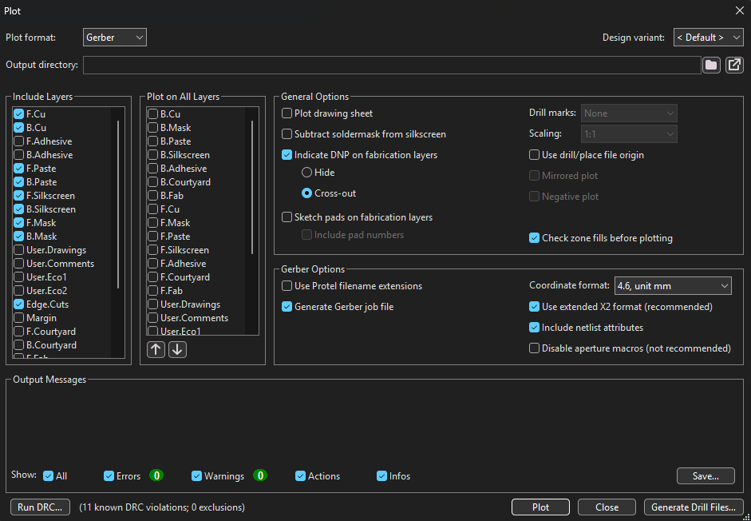

Went File > Fabrication Outputs > Gerbers, ticked all the copper layers plus the mask,
silkscreen and Edge.Cuts, then did the drill files after. Zipped the gerbers and the
drill files into one archive because that's what the fab wants, not all the files
loose. Also exported the BOM and the position file in case I end up paying for
assembly instead of soldering it myself.

Before that I cleaned up the silkscreen warnings. Moved the reference text on the
mounting holes that was hanging off the board edge, moved U2's label off its own
outline, and moved C7's label off Q1's pad. That last one actually matters a little
because silkscreen printed onto an exposed pad just gets wiped off when you solder it,
so it would have come out unreadable anyway.

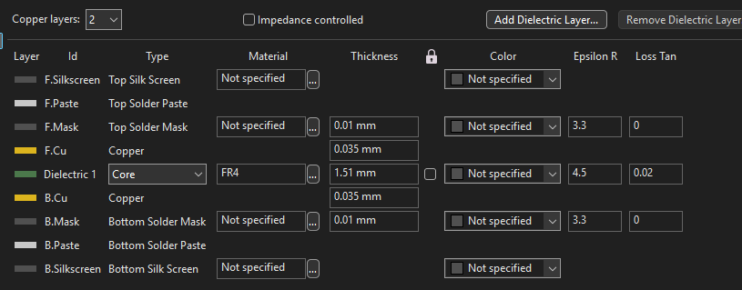

I also fixed L1's part number fields. The Value said SRN8040TA-100M which is right,
but the MPN and LCSC fields were left over from an older version of the project and
pointed at a SWPA4030S100MT. That one is 4x4mm and rated 1.5A. My footprint is 8x8mm
and I'm charging at 2.4A, so if I'd ordered off those fields I would have gotten a
part that doesn't physically fit and would have saturated anyway. SW1 had the same
problem with a totally different switch in its MPN field. Caught both before ordering
which I'm pretty happy about.

Board ended up 2 layer, 1.6mm, 90 x 60mm. The tightest copper gap anywhere on it is
0.150mm which is above JLCPCB's 0.127mm minimum so it should go through without any
special process.

# 10/12/2026 9 PM - DRC Clean

_Time spent: 3h_

Zero errors.

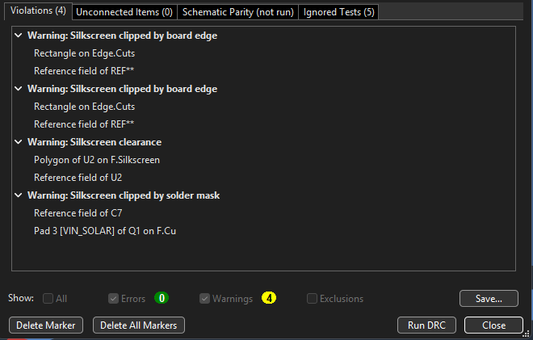

The last three things were copper that was actually overlapping, which I didn't catch
because I didn't run DRC until the end this time. Lesson learned, I should have been
running it as I went like I did on the DAC project.

My EN_BOOST trace was cutting right through SW1 pad 2, which is VBAT. That one kind of
scared me because SW1 is the on/off switch and connecting those two nets is literally
its entire job. If I'd shorted them in copper the boost would just be on permanently
and the switch would do nothing, and the board would have "worked" so I probably never
would have figured out why the switch didn't do anything.

Second one was my CHRG_STATE trace clipping C2 pad 1 by 0.025mm. Third was a +5V trace
sitting 0.013mm away from R14 pad 2, which is the boost feedback node. That one wasn't
technically touching but 13 microns is basically nothing, it would have etched into a
short and then my 5V output would have run away to whatever its limit is.

The EN_BOOST into U2 pin 2 thing took me the longest by far. U2 is a SOT-563 and the
pads are only 0.150mm apart. Pin 3 right next to pin 2 is VBAT, which I had in my
Battery net class at 0.25mm clearance, and KiCad uses whichever of the two clearances
is bigger. So it was asking for 0.25mm of space in a 0.150mm gap. The pads were failing
DRC before I even drew anything, which is why no matter what width I used all I could
get was a tiny stub that barely touched the pad. I dropped every net class clearance to
0.12mm and it went in first try at 0.25mm wide, running straight along y=85.000, dead
center between pins 1 and 3.

I checked what was in the Ignored Tests list too, just to make sure the zero was real
and wasn't hiding stuff.

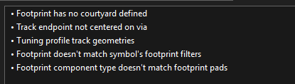

All five are harmless. No courtyard defined, track endpoint not centered on via, tuning
profile geometries which only matters for length matched differential pairs that I
don't have, footprint filters, and component type vs pads. None of them are clearance
or connectivity so the zero is actually a zero.

The 4 warnings that are left are all silkscreen, same as my last project.

# 10/12/2026 5 PM - The USB-C Routing Nightmare

_Time spent: 4h_

This was the worst part of the whole project and it turned out to not even be my fault.

Every single time I tried to start a trace on the USB-C ground pads I got "The route
starting point violates DRC." I tried everything I could think of. Dropped the track
width to 0.5mm, then 0.4, then 0.25. Changed the Ground net class. Changed copper to
hole clearance from 0.25 down to 0.15. Went through my whole constraints page.

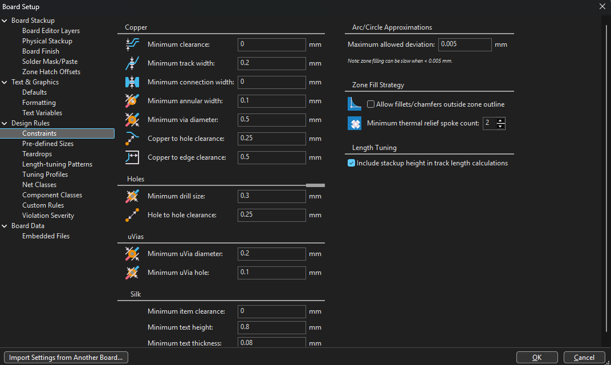
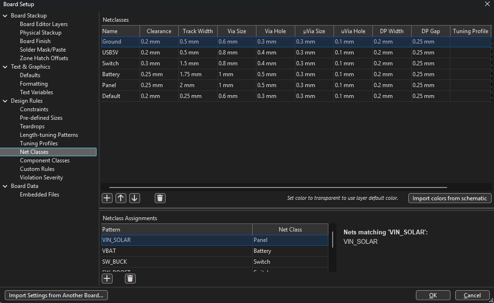

Nothing worked, it just kept refusing.

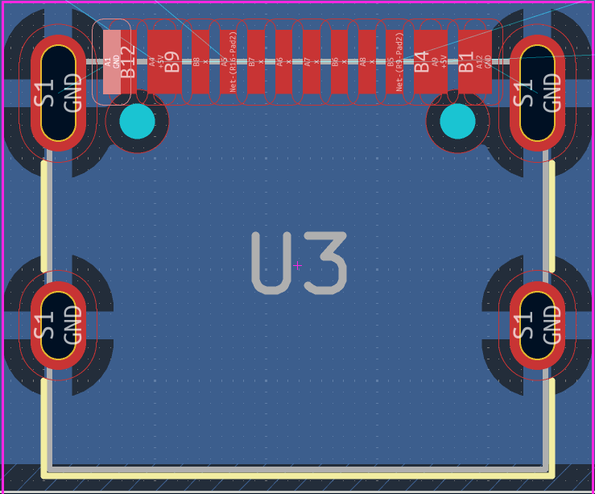

Turns out four of the USB-C pads, B12, B9, B4 and B1, had no net on them at all. The
schematic sitting in my project folder was an older copy where the USB-C symbol only
had the A row pins plus B5 through B8, so those four pads on the footprint had nothing
to map to. KiCad won't start a route from a pad with no net, and on top of that A1 and
B12 touch edge to edge, so having them on different nets is an automatic clearance
violation that no setting is ever going to fix.

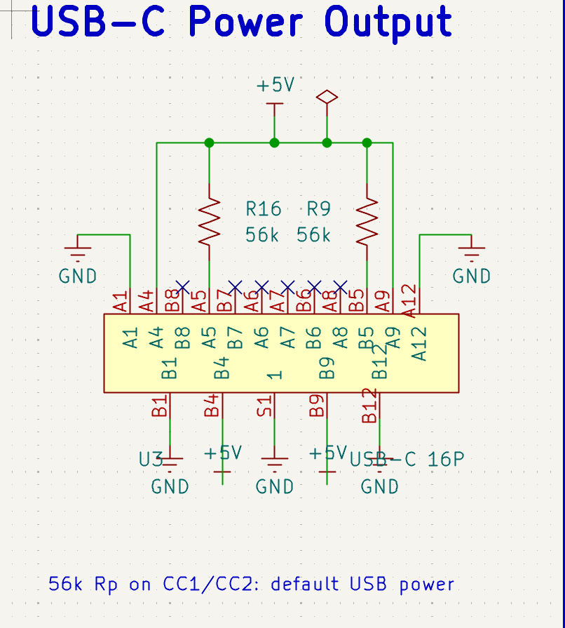

Swapped the corrected schematic in and ran Update PCB from Schematic. Everything I'd
already routed stayed exactly where it was because the symbol UUIDs still matched, so I
didn't lose any work. The four pads picked up GND and +5V and the route went in
straight away.

Then I hit the same thing again in a different form. The F8 update relinked U3 to the
stock Connector_USB library instead of my project one, and the stock footprint calls
its shield pads SH while my symbol called the pin S1. So all four shield posts came out
with no net, which meant the ground I was routing into them was connecting to nothing
at all. Renamed the pin in the symbol to SH so they matched and that sorted it.

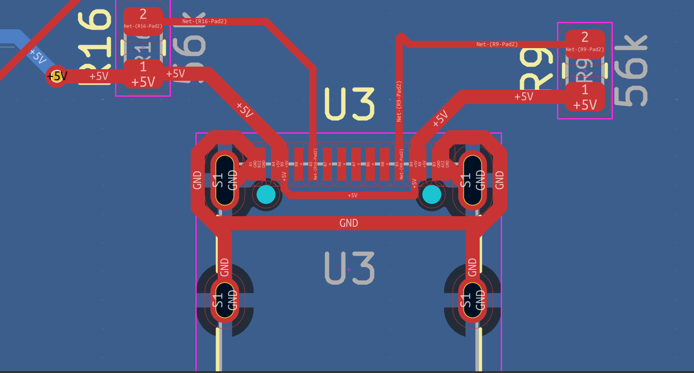

If a pad is doing something that seems impossible, check whether it actually has a net
before you spend three hours messing with clearance settings.

# 10/11/2026 2 PM - Routing the Power Sections

_Time spent: 5h_

Did the parts that actually matter first, which is the two switching loops.

For the buck side I routed Q1 to D1 to L1 as short as I could get it and kept the whole
thing on the top layer with no vias inside the loop. Loop area is what causes ringing
and radiated noise so the tighter it is the better the thing behaves. I nudged C6, C7
and D1 in a bit before I started and got the loop down from around 110mm2 to 84mm2.

The three ground returns in that loop each got their own via placed right at the pad
instead of all sharing one, because if the return current has to travel sideways to find
a via then you've just reopened the loop you closed.

The boost side is the same idea but a lot tighter, because U2 is a SOT-563 and every
trace going into it has to neck down to 0.30mm or less for the last millimetre. That
isn't me cutting corners, the chip's own lead frame is narrower than that.

The thing that took me longest to understand was that the trunk of a net and the
branches off it are different things. I kept trying to run a 2mm VIN_SOLAR trace
directly onto U1 pin 9 and it physically would not land, and it turns out pin 9 is just
the chip's own supply pin drawing about 1mA, it isn't part of the power path at all. So
the fat trace goes P1 to C6 to C7 to Q1, and then thin 0.25 to 0.4mm taps come off it
for the supply pin and the dividers. Once that clicked the rest of it made a lot more
sense.

For the current sense I ran both R5 traces starting on R5's own pads instead of
branching them off the VBAT trunk. The chip reads 120mV across a 0.05 ohm resistor, so
a few milliohms of shared trace resistance would shift my actual charge current by
enough to notice.

# 10/10/2026 7 PM - PCB Setup and Placement

_Time spent: 3.5h_

Set the board up properly before touching any copper this time instead of figuring it
out as I went like last project.

Made net classes for Ground, USB5V, Switch, Battery and Panel so the power nets get wide
traces automatically and I'm not setting the width by hand every single time. Battery
got 1.75mm and Panel got 2mm since those are the ones carrying real current.

Board outline is 90 x 60mm with four M3 mounting holes 4mm in from each corner. The
whole thing is meant to bolt onto the back of the solar panel so it actually has to
mount to something.

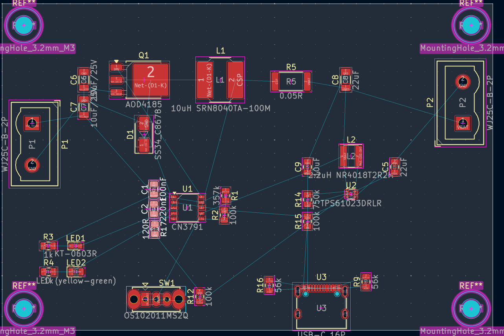

For placement I grouped things by what they do instead of just scattering them around.
Panel input and the buck converter across the top, the CN3791 and all its support parts
in the middle, boost and USB-C in the bottom right, and the status LEDs and the switch
along the bottom left where you'd actually be able to see and reach them.

Then I put a ground pour on the bottom layer across the whole board. Remembered from the
DAC project to press B after every change so the pour actually refills, which saved me
some confusion this time.

# 10/8/2026 8 PM - Sorting Out the Footprint Libraries

_Time spent: 2.5h_

My footprints were pointing at libraries sitting outside the project folder, which I
didn't want, because if any of those ever move or get deleted my project just breaks.

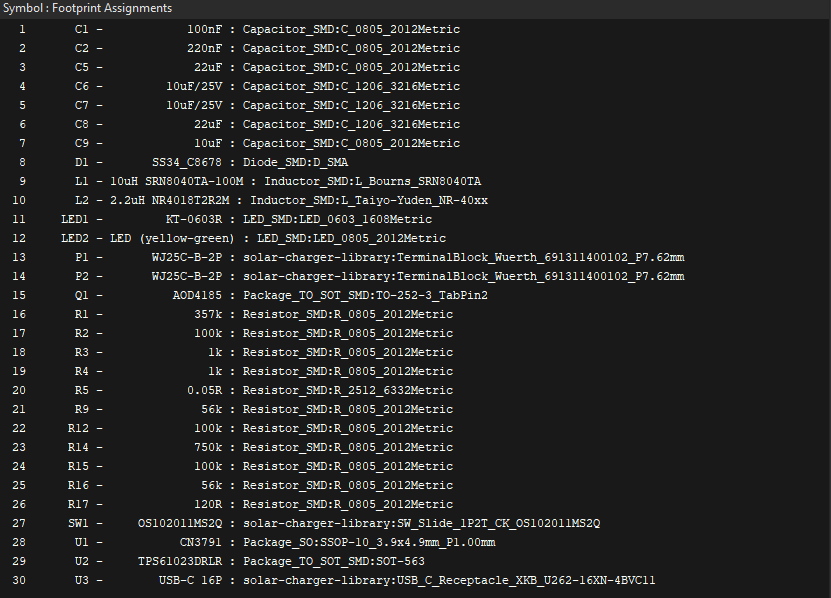

Swapped everything over to stock KiCad footprints, which covered all of it except four
parts. The two terminal blocks, the slide switch and the USB-C connector didn't resolve
on my install, so I made a project local library folder and put those four in there. Now
the whole thing is self contained and travels with the repo.

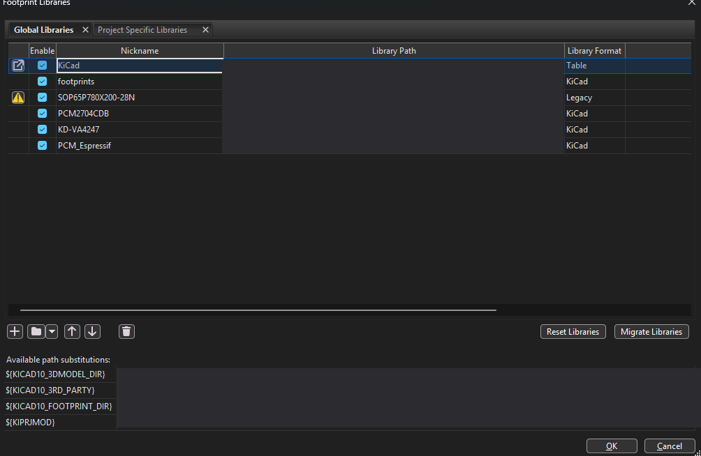

Importing them into the PCB was annoying though. I got duplicate footprints all over the
place because the UUIDs didn't match up, and I had to use "Re-link footprints to
schematic symbols based on their reference designators" and then delete the footprints
with no symbols to clean it all up.

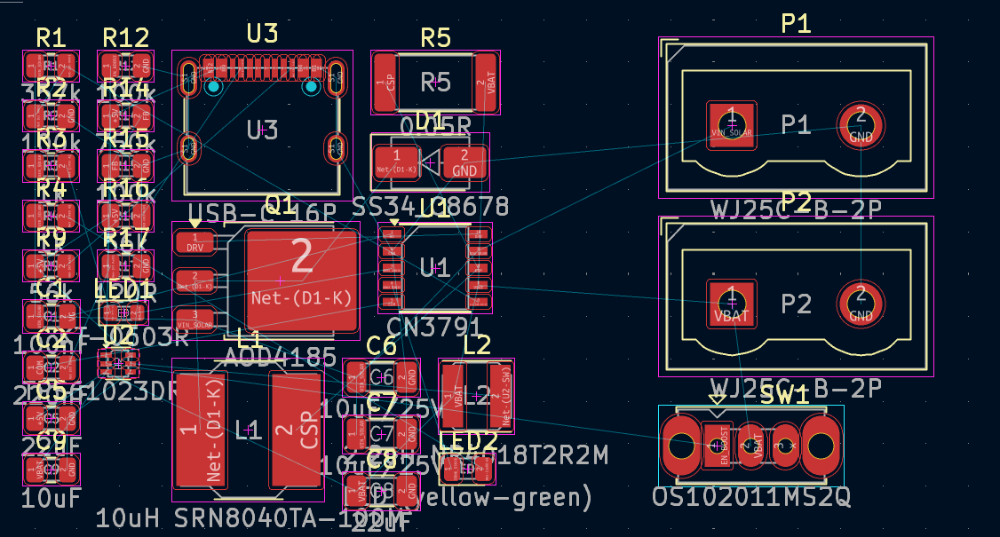

Then I got "Error: U3 pad S1 not found in
Connector_USB:USB_C_Receptacle_XKB_U262-16XN-4BVC11" which took me a while to work out.
My installed version of that footprint names the shield pads SH, and the one my symbol
was expecting calls them S1. Copied the official footprint into my project library and
that fixed it. This exact thing came back and bit me again on 10/12 lol.

# 10/6/2026 6 PM - Panel Choice and Going to Three Cells

_Time spent: 2h_

Realized partway through that I hadn't actually thought about the panel at all, which
for a solar project is kind of the whole point.

Worked out that the MPPT setpoint is set by the R1/R2 divider. It's 1.205 x (1 + R1/R2),
so with 357k and 100k that comes out to 5.51V. The rule of thumb is you set the MPPT
point at about 80% of the panel's open circuit voltage, which puts the panel I need at
around 6.9V Voc, so a 6V nominal one.

Then I went from one cell to three in parallel. One 18650 at around 3000mAh wasn't
really enough to be worth anything, three gets me around 9000mAh which is roughly two
and a half phone charges.

Something I had to look up that I didn't know: you can't just parallel three protected
cells. The protection boards don't coordinate with each other and they end up fighting.
You use three unprotected cells with one BMS across the whole pack instead.

Going to three cells also meant more charge current so R5 went to 0.05 ohm. Charge
current is 120mV / Rcs, so that's 2.4A now.

# 10/4/2026 9 PM - Fixing Everything Wrong With the Schematic

_Time spent: 4h_

Went back through the schematic properly and checked every value against the datasheets,
and there was a good amount wrong with it.

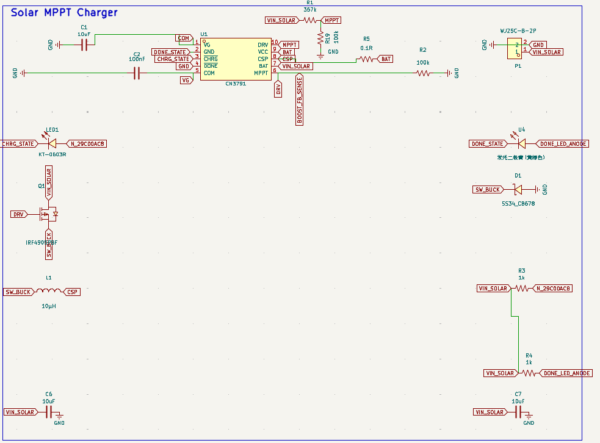

The big one was the boost converter feedback. The TPS61023 has a 0.595V reference and I
had been working off 0.8V, so the divider setting the output voltage was wrong and my 5V
rail would not have been 5V at all. Redid it as 750k and 100k which gets me 5.06V.

Second one, the CC resistors on the USB-C were 5.1k. That's what you use when you're a
device asking for power. This board is the thing providing the power, so it needs pull
ups to +5V instead of pull downs. Changed them to 56k.

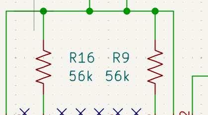

Third, the charge current sense resistor was 0.1 ohm, which works out to 1.2A, which
wasn't what I wanted.

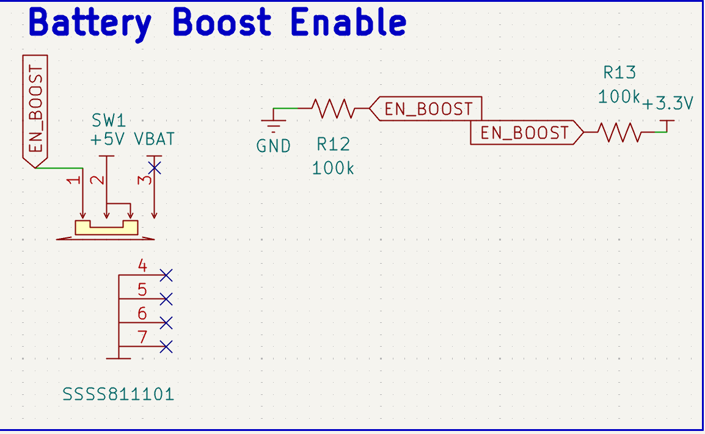

The boost enable sheet also had a 3.3V net on R13 that didn't go anywhere useful, and
SW1 pin 3 was unconnected, which is actually fine since that's the off position, but it
needed a no connect flag so ERC would stop complaining about it.

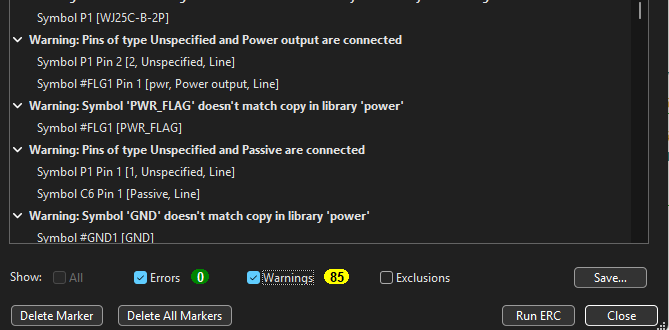

Also cleaned up the layout of the schematic itself so it reads left to right in the
order the power actually flows through it, instead of parts sitting wherever I first
dropped them. Added power flags where ERC wanted them.

# 10/1/2026 10 PM - Parts and First Schematic

_Time spent: 3h_

Picked the parts for this.

For the charger I went with the CN3791 because it's a buck MPPT charger made
specifically for solar, which means it tracks the panel's maximum power point instead of
just dragging the panel down until it stalls. That's the part that makes this an actual
solar charger and not just a charger you happen to plug a panel into.

For the boost I went with the TPS61023 to get from one lithium cell back up to 5V for
USB.

So the chain ends up being panel into P1, CN3791 charges the pack through Q1 and L1,
battery sits on P2, TPS61023 boosts it back up to 5V, and out through USB-C.

First pass at the schematic, mostly working off the CN3791 and TPS61023 datasheets and
their reference designs. It's rough and I already know some of the values need checking,
but I wanted the whole chain down on one page before worrying about whether every number
was right.

# 9/28/2026 11 PM - Planning

_Time spent: 1.5h_

Wanted my next project after the DAC adapter to be something that actually does
something for someone, and I landed on solar charging. Around 700 million people don't
have reliable electricity but phones are basically everywhere, so a solar charger is one
of the few things you can build where the problem and the thing you're making are both
real.

The scope I settled on is a panel input, MPPT charging into a lithium pack, and a 5V
USB-C output. Two layers so it's cheap to get made.

The part I want to get right is the MPPT. A dumb charger hooked to a panel pulls it down
below its maximum power point and you lose a big chunk of what the panel could actually
be giving you, and that gets worse in weak light which is when you need it most.
