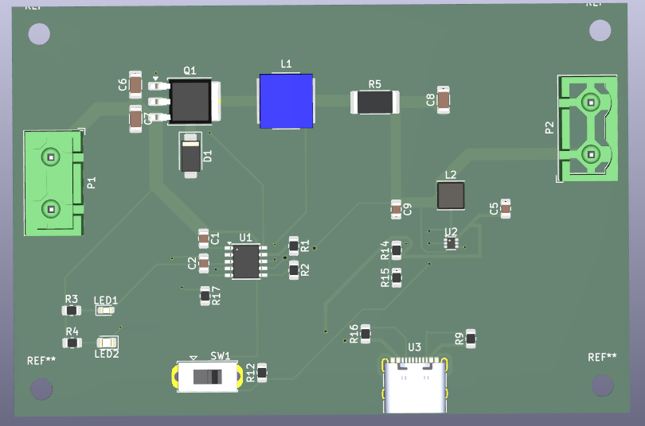
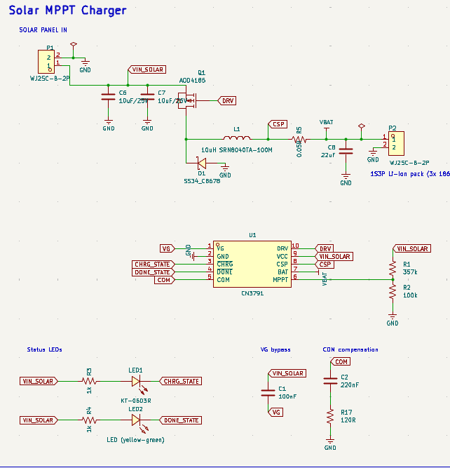
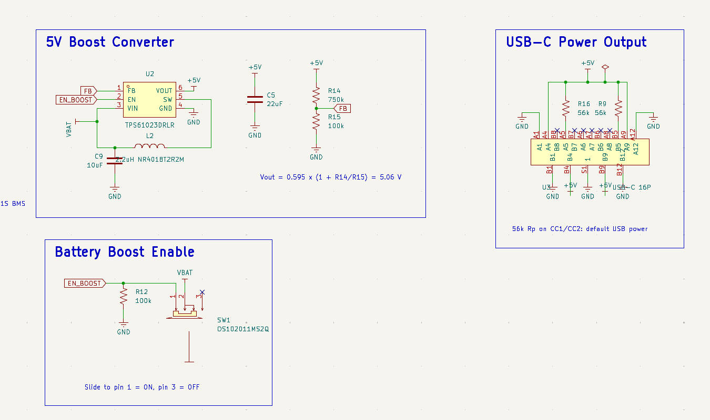
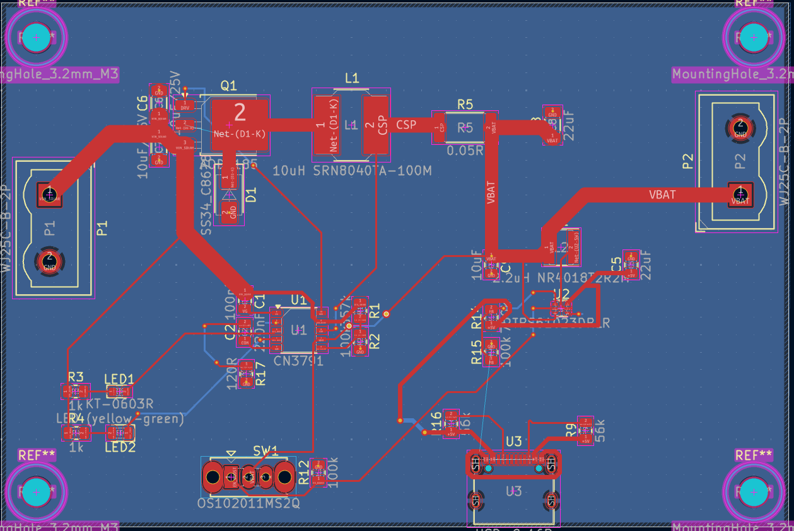
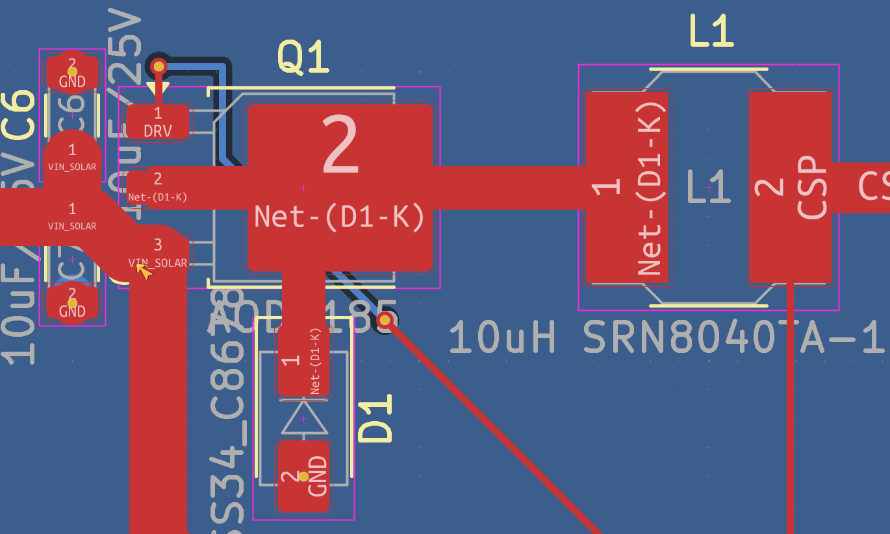
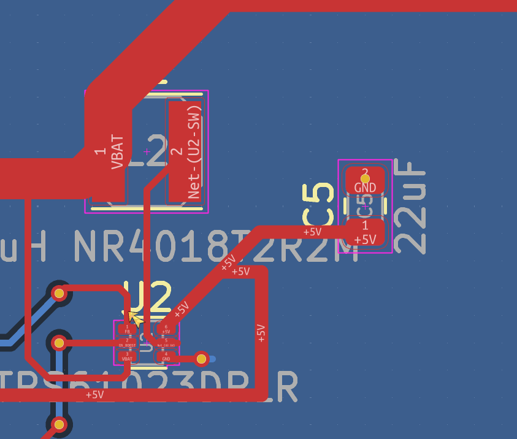
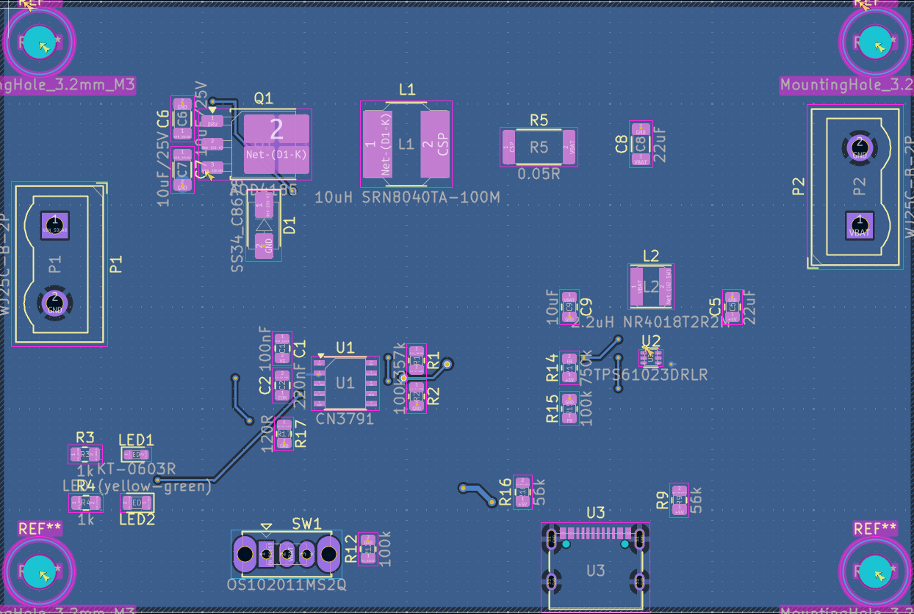
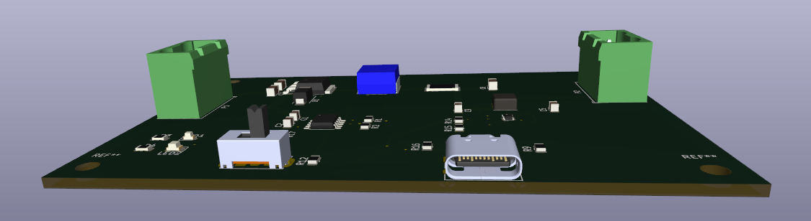
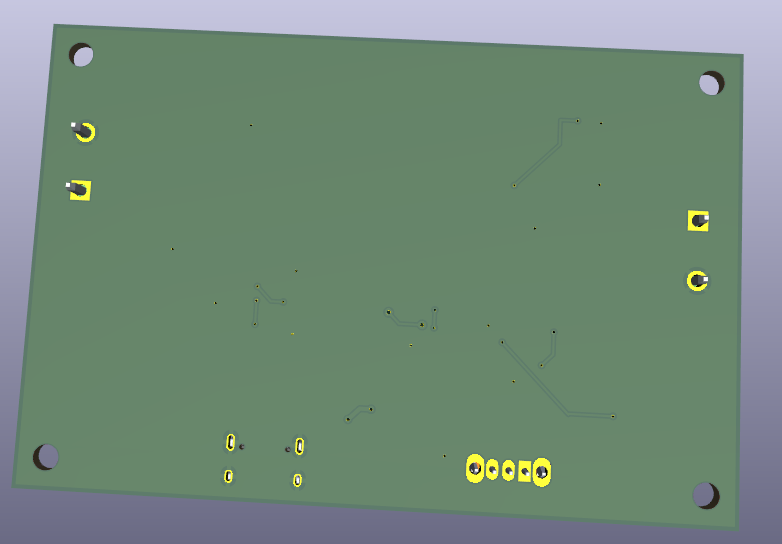

# Solar USB-C Charger

A solar charge controller with MPPT and a 5V USB-C output. You wire a 6V solar panel
into one terminal block and a 1S lithium pack into the other, and it charges the pack
at up to 2.4A while holding the panel at the voltage where it puts out the most power,
then boosts back up to 5V for the USB port.

2 layer board, 90 x 60mm, 30 components, done in KiCad 10.



## Why I made it

Around 700 million people don't have reliable electricity, but phones are basically
everywhere, so a solar charger is one of the few things you can build where the problem
and the thing you're making are both real.

The part that makes this worth building instead of just buying one is the MPPT. A solar
panel has one specific voltage where it gives you the most power, and a dumb charger
ignores that and just pulls the panel down until it stalls out. You end up losing a big
chunk of what the panel could have given you, and it gets worse in weak light, which is
when you actually need it. This board watches the panel voltage through a divider and
holds it at that point instead.

I also didn't want it tied to one specific panel. Anything in the input range works, so
someone with a different panel can still use the board.

## How it works

```
solar panel --> P1 --> CN3791 MPPT buck charger --> P2 --> 1S3P 18650 pack
                         (Q1, L1, D1, R5)                        |
                                                                 v
                           USB-C out <-- TPS61023 boost <-- SW1 enable
                              U3            (U2, L2)
```

U1 is the CN3791, a buck MPPT charger made for solar. It holds the panel at its maximum
power point and does CC/CV charging into the pack. Q1 is the high side switch for the
buck and R5 sets the charge current, since the chip regulates to 120mV across it.

U2 is the TPS61023, which takes the single cell back up to 5V. SW1 turns it on and off
so the board isn't draining the pack when nothing is plugged in.

U3 is the USB-C receptacle. All four VBUS contacts and all four ground contacts are
wired, which is how the current gets shared instead of going through one pin.

### The numbers and where they come from

| what | value | set by |
|---|---|---|
| MPPT setpoint | 5.51V | 1.205 x (1 + R1/R2), R1 357k, R2 100k |
| Panel you need | about 6.9V Voc, 11W or more | setpoint divided by 0.8 |
| Charge current | 2.4A | 120mV / R5, R5 is 0.05 ohm |
| Output voltage | 5.06V | 0.595 x (1 + R14/R15), R14 750k, R15 100k |
| CC pull ups | 56k | R9 and R16, which is what tells a phone it can draw default USB power |

If you want to use a different panel, change R1 and R2. If you want a different charge
current, change R5.

## Pictures

Schematic:




PCB:



The buck switching loop, with Q1, D1 and L1 kept as tight as I could get them and each
ground return taking its own via right at the pad:



The boost section around U2 and L2:



Bottom layer with the ground pour:



3D:




## What's in this repo

```
README.md                      this
JOURNAL.md                     build log with everything that went wrong
BOM.csv                        parts list with links
hardware/
  Solar_charger_3.kicad_pro    project file
  Solar_charger_3.kicad_sch    schematic
  Solar_charger_3.kicad_pcb    board
  solar-charger.pretty/        footprints for the 4 parts KiCad doesn't have
  solar-charger.3dshapes/      3D models for those same parts
  gerbers.zip                  manufacturing files
images/                        screenshots
```

## How to build one

### Order the board

Send hardware/gerbers.zip to any fab. 2 layer, 1.6mm, 1oz copper, HASL or ENIG. The
tightest copper gap on the board is 0.150mm which is inside JLCPCB's 0.127mm minimum so
you don't need anything special.

### Order the parts

Everything is in BOM.csv with links. Get spares of U1, U2 and U3, those are the three
most likely to get wrecked by a bad solder joint.

### Solder it

Do U1 and U2 first while the board is still empty, they're the hardest. U2 is a SOT-563
with 0.5mm pitch so check it under magnification for bridges after. Then all the
resistors and capacitors, then Q1, D1, L1 and L2. Q1's tab needs enough heat to actually
wet. Then U3, and remember the four shield posts are through hole and carry ground. Then
P1, P2 and SW1 last since they're through hole.

### Build the battery pack

Three 18650 cells in parallel with one 1S BMS across the whole pack.

Use unprotected cells for this. If you parallel three cells that each have their own
protection board, the boards don't coordinate with each other and they fight. One BMS for
the pack is the right way to do it.

### Test it before you connect a battery

Check P1 and P2 for shorts between + and - first. Then put a bench supply on P1 at 6V
with the current limit at 500mA. The board should only draw a few mA. Check that U1 pin
9 reads your input voltage, and that U1 pin 6 sits near 1.205V once the loop is
regulating.

Only after that, connect the pack to P2 with SW1 off. Then switch it on and measure the
USB-C output, you should get 5.0V give or take 0.1V.

### Mount it

Four M3 holes, 4mm in from each corner. It's meant to bolt onto the back of the panel.

## Wiring

P1 pin 1 is panel +, pin 2 is panel -. P2 pin 1 is pack +, pin 2 is pack -.

The panel and the battery are not on the board. They're external and they wire into the
two screw terminals.

## Known issues

The board hasn't been fabricated or tested yet, everything here is verified in KiCad
only.

Three of the part number fields in the schematic are stale and don't match the
footprint. L1's MPN field names a 4x4mm 1.5A inductor when the correct one is in the
Value field, SW1's MPN names a completely different switch, and U3's LCSC code needs
checking against the XKB footprint. Order from BOM.csv and not from those fields.

There are four cosmetic silkscreen warnings left in DRC that don't affect anything
electrically.

There's no reverse polarity protection on P1, so wire the panel the right way round.

No enclosure yet, and no battery percentage readout. Both are below.

## What I want to add

A fuel gauge board. A MAX17048 across the pack with a small OLED, taking power and I2C
off the P2 terminals so the main board doesn't have to change at all. It'd sit behind a
momentary button, because an OLED left on all the time would quietly eat whatever the
panel is bringing in.

An I-V curve tracer, so I can actually measure a panel's real maximum power point with a
swept load and a current sensor, and then check that the CN3791 is parking on it instead
of just assuming it does.

## Credits

U1 is the Consonance CN3791 and U2 is the TI TPS61023. Both were designed in from their
datasheets.

Footprints and 3D models come from the KiCad standard libraries, except the terminal
blocks, the slide switch and the USB-C connector, which are in
hardware/solar-charger.pretty and hardware/solar-charger.3dshapes in this repo.

## License

MIT
